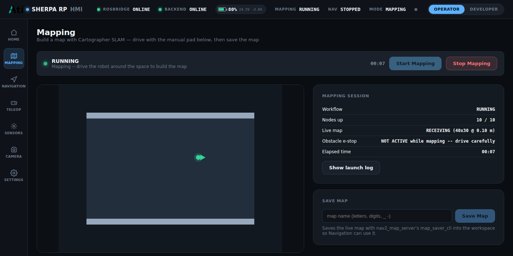
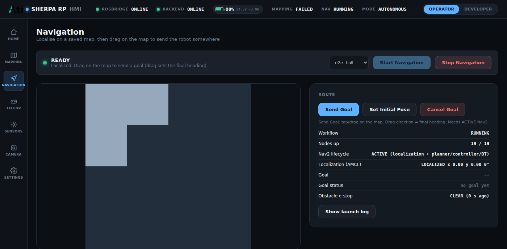
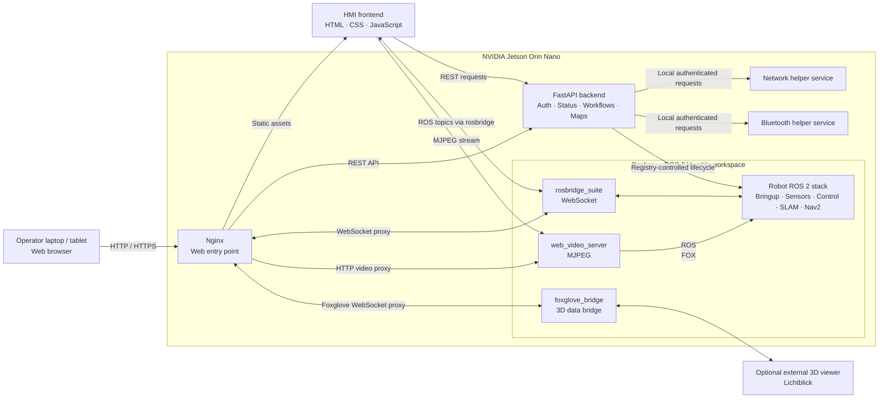

# Sherpa RP HMI — Public Architecture Showcase

A browser-based Human–Machine Interface (HMI) for operating and monitoring the Sherpa RP autonomous mobile robot (AMR). This repository presents the **real system architecture, frontend capabilities, backend responsibilities, ROS 2 integration model, deployment topology and selected UI captures** for technical reviewers and hiring teams.

Developed by E MADAN KUMAR during the Robotics & AI internship at ATI Motors (New Product Initiative). Published with permission from ATI Motors.

> **Source-code availability**  
> This is an architecture and portfolio showcase. The proprietary frontend implementation, backend source, ROS 2 workspace, deployment scripts, private configuration and credentials are intentionally not included. **For the complete source code, contact E MADAN KUMAR.**

## Project at a glance

| Area | Technology / component |
|---|---|
| Robot platform | Sherpa RP autonomous mobile robot |
| On-robot computer | NVIDIA Jetson Orin Nano |
| Robotics middleware | ROS 2 Humble |
| Runtime isolation | Docker container for the ROS 2 workspace |
| Web frontend | Static HTML, CSS and JavaScript, accessed from a browser |
| Backend | Python FastAPI service |
| Web edge / reverse proxy | Nginx |
| ROS web access | rosbridge WebSocket using roslibjs on the browser side |
| Camera stream | ROS `web_video_server` using MJPEG over HTTP |
| 3D diagnostics | foxglove_bridge with an external viewer such as Lichtblick (optional integration path) |
| Local device services | Separate network and Bluetooth helper services |

## Frontend showcase

The HMI groups operator tasks into focused screens for **Home, Mapping, Navigation, Teleoperation, Sensors, Camera and Settings**, with separate login and developer-facing areas. The shared dashboard provides high-level robot connectivity and operating-state indicators.

### Mapping

*Mapping screen capture supplied with the project archive. It illustrates the live map area, mapping workflow status, node readiness, map-save panel and manual-drive section.*

### Navigation

*Navigation screen capture supplied with the project archive. It illustrates saved-map selection, goal and initial-pose controls, route/workflow information, Nav2 readiness and the local stop control.*

These are UI captures from the supplied project archive, not a claim of a currently connected live robot session.

## Architecture overview

The operator uses a normal browser on a laptop or tablet. The browser does not need a ROS 2 installation and does not communicate with DDS directly. Requests enter through Nginx on the Jetson, which serves the frontend and routes API, ROS WebSocket and video traffic to the appropriate on-robot service.

For the detailed component responsibilities, message paths, workflows, safety boundaries and deployment notes, see **[ARCHITECTURE.md](ARCHITECTURE.md)**.

## Key capabilities represented in the architecture

- **Robot overview:** a common dashboard for robot status, connectivity, battery and operating mode.
- **Teleoperation:** browser-based manual driving with an explicit HMI safety enable and a dedicated manual command path.
- **Mapping:** start/stop the mapping workflow, visualize the incoming occupancy grid and save a map for later navigation.
- **Navigation:** select a saved map, initialize localization, set a navigation goal, monitor Nav2 readiness and cancel a goal.
- **Sensors and diagnostics:** present the available sensor and robot-state information to the operator.
- **Camera:** display the robot camera through a dedicated MJPEG video path.
- **Network and Bluetooth:** request supported device operations through backend-mediated local services.
- **Deployment:** serve the browser interface through Nginx while the robot-side ROS 2 stack runs in a Docker environment.

## Important engineering boundaries

- The HMI is an operator interface and workflow coordinator; it is **not** a replacement for the robot's motor controller or safety-rated hardware.
- Manual velocity commands enter through the dedicated teleoperation input and continue through the robot's downstream mux and safety gate. The HMI does not publish directly to the final motor command interface.
- A lost ROS WebSocket connection, invalid operating state or disabled HMI safety state must prevent continued teleoperation commands.
- The mapping launch described in the supplied project notes does not include the Livox obstacle-avoidance publisher. Automatic obstacle stopping must therefore not be assumed active during mapping; operators must follow the robot's approved operating procedure.
- An independent, accessible physical emergency stop remains necessary.

## Verification notes

The supplied project documentation reports backend automated tests, launch-registry checks and browser end-to-end tests using Docker/ROS bridge test doubles. Those test doubles are not equivalent to a full Jetson + physical Sherpa RP acceptance test. Robot-side launch, sensor, network, teleoperation, mapping and navigation behavior must be verified on the target hardware before operational use.

Some interface names, device ports, bridge ports and motion limits are explicitly marked as assumptions requiring integration verification in the supplied architecture notes. Treat those as configuration items to confirm against the deployed robot, not universal constants.

The supplied architecture notes also identify a minimal local `roslibjs` stub in the archived frontend bundle. Confirm that the production build uses the official, compatible ROSLIB distribution before treating the WebSocket integration as production-ready. The external 3D-viewer path is optional; the exact operator-facing view and bridge availability should be confirmed in the target deployment.

## Maintainer

**E MADAN KUMAR**  
GitHub: [@madankumar477](https://github.com/madankumar477)

## Source-code access

This public repository intentionally contains architecture documentation and selected UI screenshots only. It does not distribute the complete frontend, backend, ROS 2 workspace, deployment implementation or private configuration.

**For the complete source code, contact Madan.**

---

*Sherpa RP name, screenshots and architecture information are shown with permission from ATI Motors.*
